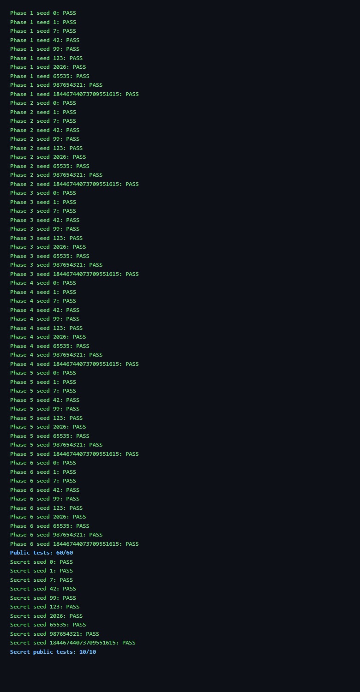

# ICS-2026 BombLab 实验报告

## 1. 实验概述

本实验（CSAPP 第三章配套）要求在没有源码的情况下，用反汇编和 GDB 分析一个 64 位
Linux 程序 `bomb`，理解其中的函数调用、分支、循环、递归、指针与间接调用，并在
`defuser.c` 中实现从 `challenge` 算出口令的求解函数。

每个关卡收到一个 `challenge`（由 seed 和关卡号经过 splitmix64 生成），口令随它变化。
因此解法是"计算程序"，而不是固定的六个密码。

本报告覆盖正式六关（Phase 1–6）与 Honor（secret）的分析、恢复出的计算关系、推理过程
和验证记录。

## 2. 实验环境与工具

- 系统：Linux x86_64（WSL Ubuntu）
- 工具链：GCC、GNU Make、Python 3.10+、GDB、binutils（objdump）
- 分析方法：
  - `objdump -d` 导出各关汇编，离线阅读；
  - GDB 停在关键比较指令处，核对寄存器与内存值；
  - `./defuser --seed N | ./bomb --seed N` 与 `python3 public_test.py` 验证。

## 3. 各关卡分析

说明：下面所有算术均为 32 位无符号（`uint32_t`），加、减、乘按模 2³² 回绕；`ch` 表示
本关的 64 位 `challenge`。

### 3.1 Phase 1（phase_01 @ 0x402090）

关键汇编（入口调用 `p1_compute`）：

```asm
; phase_01 解析 1 个整数后：
mov    %r12,%rdi          ; rdi = ch
call   402050 <p1_compute>
cmp    %eax,-0x14(%rbp)   ; 输入 == 结果 ?
sete   %al

; p1_step0:  eax = (edi*5 + esi) ^ 0x100e
; p1_step1:  eax = (edi*5) ^ (esi + 0x8a3d)
; p1_step2:  eax = (edi - esi)*3 + 0xd8b9

; p1_compute:
mov    %edi,%esi          ; esi = lo32(ch)
shr    $0x20,%rax         ; rax = ch>>32
shr    $0x10,%rdx         ; rdx = ch>>16
call   p1_step2           ; p1_step2(hi32, lo32)
call   p1_step0           ; p1_step0(lo32, lo32(ch>>16))
call   p1_step1           ; p1_step1(上一步, p1_step2 结果)
```

恢复出的计算关系：

```
a = lo32(ch),  b = lo32(ch>>16),  c = hi32(ch)
s2 = p1_step2(c, a) = (c - a) * 3 + 0xd8b9
s0 = p1_step0(a, b) = (a * 5 + b) ^ 0x100e
answer = p1_step1(s0, s2) = (s0 * 5) ^ (s2 + 0x8a3d)
```

推理：入口处 `rsi` 为 challenge；`p1_compute` 把 challenge 拆成低 32 位、`>>16` 低
32 位、`>>32` 高 32 位三段，依次调用三个 helper 组合。注意三次 `call` 之间寄存器的含义
已改变，需按每次调用重新判断参数。

### 3.2 Phase 2（phase_02 @ 0x4020f0）

关键汇编：

```asm
; 首项
mov    %r13,%rax
shr    $0xc,%rax
and    $0x7f,%eax          ; f[0] = (ch>>12) & 0x7f
cmp    %eax,%esi           ; 输入[0] == f[0]

; 循环 (edx = i 从 1 到 5, cl = 22 起每次 +2)
mov    %r13,%rax
shr    %cl,%rax
and    $0x1f,%eax          ; (ch>>cl) & 0x1f
add    %edx,%eax           ; + i
xor    %esi,%eax           ; ^ f[i-1]
lea    (%rax,%rax,2),%eax  ; * 3
mov    -0x40(%rbp,%rdx,4),%esi  ; f[i]
cmp    %eax,%esi           ; f[i] == 3*(...) ?
```

恢复出的计算关系（6 个整数，`i = 1..5`）：

```
f[0] = (ch >> 12) & 0x7f
f[i] = 3 * ( f[i-1] ^ ( ((ch >> (20 + 2i)) & 0x1f) + i ) )
```

推理：`valid_u32_fields(input, 6)` 先校验一行有 6 个无符号整数，`sscanf` 格式为
`"%u %u %u %u %u %u"`。第一个整数与 `(ch>>12)&0x7f` 比较，随后是一个 5 次循环，每次把
`ch` 右移 `22,24,26,28,30` 位、取低 5 位、加上循环下标，与上一项异或后乘 3，作为下一项。

### 3.3 Phase 3（phase_03 @ 0x4022b0）

关键汇编：

```asm
mov    %r12d,%edi
and    $0x7,%edi           ; idx = ch & 7
cmp    %edi,-0x18(%rbp)    ; 输入[0] == idx
shr    $0x3,%rax           ; ch>>3
shr    $0x20,%rsi          ; ch>>32
xor    %eax,%esi           ; value = (ch>>3) ^ (ch>>32)
call   402250 <p3_dispatch> ; dispatch(idx, value)
cmp    %eax,-0x14(%rbp)    ; 输入[1] == 结果

; p3_dispatch: jmp *0x405820(,%rax,8)  跳转表 8 项
```

恢复出的计算关系：`idx = ch & 7`，`value = lo32(ch>>3) ^ hi32(ch)`，第二个整数由跳转
表 0x405820 按 `idx` 分派到 8 个 case：

| idx | case | 结果 (32 位) |
|----|------|--------------|
| 0 | case_7 | `v*5 + 0x2d2a8` |
| 1 | case_3 | `v*5 + 0x31a06` |
| 2 | case_2 | `v*5 + 0x4141` |
| 3 | case_0 | `(v ^ 0xec1b) + (v >> 2)` |
| 4 | case_5 | `(v*4) ^ 0xcb5d` |
| 5 | case_4 | `v*5 + 0x4f25` |
| 6 | case_1 | `(v*4) ^ 0x18bf` |
| 7 | case_6 | `(v ^ 0xbdaf) + (v >> 1)` |

推理：入口先用 `and $0x7` 得到 0–7 的索引，与输入第一个整数比较；`p3_dispatch` 里
`cmp $0x7,%eax; ja 返回0` 越界保护后通过 `notrack jmp *0x405820(,%rax,8)` 间接跳转。
`0x405820` 处是 8 个指向 `p3_case_*` 的分派地址，每个 case 都是对 `edi`（value）的简单
位运算 / 线性运算。

### 3.4 Phase 4（phase_04 @ 0x4023a0）

关键汇编：

```asm
mov    %r12d,%edi
and    $0x7f,%edi          ; a = ch & 0x7f
shr    $0x7,%rcx           ; rcx = ch>>7
shr    $0x20,%rax          ; rax = ch>>32
xor    %eax,%ecx           ; d = (ch>>7) ^ (ch>>32)
mov    $0x7f,%edx          ; c = 0x7f
xor    %esi,%esi           ; b = 0
call   402330 <p4_walk>    ; p4_walk(a, 0, 0x7f, d)

; p4_walk: mid = b + (c-b)/2
cmp    %eax,%edi           ; a == mid ?
je     402390              ;   返回 (mid+0x28) ^ d
cmp    %edi,%eax           ; a < mid ?
jb     402370              ;   左：返回 (3*p4_walk(a,b,mid-1,d) ^ (mid+d)) ^ 0x3
                           ;   右：返回 (3*p4_walk(a,mid+1,c,d) ^ (mid+d)) ^ 0xb
```

恢复出的计算关系：

```
a = ch & 0x7f,   d = lo32((ch>>7) ^ (ch>>32))

p4_walk(a, b, c, d):
    mid = b + (c - b) / 2
    if a == mid: return (mid + 0x28) ^ d
    if a < mid:  return (3 * p4_walk(a, b, mid-1, d) ^ (mid+d)) ^ 0x3
    else:        return (3 * p4_walk(a, mid+1, c, d) ^ (mid+d)) ^ 0xb
```

推理：`p4_walk` 是递归的二分查找：`[0,127]` 区间里找 `a`，递归返回后逐层把结果乘 3、
异或 `(mid+d)`，再按"向左 / 向右"分别异或 `0x3` / `0xb`。`a` 取自 `ch&0x7f`，一定落在
`[0,127]`，递归必然在 `a==mid` 处终止，深度不超过 7。

### 3.5 Phase 5（phase_05 @ 0x402490）

关键汇编：

```asm
call   402420 <p5_traverse>  ; eax=累计值, *out=最后节点 v1

; p5_traverse:
and    $0x7,%eax             ; index = ch & 7
mov    0x405b60(,%rax,8),%rdx ; node = table[index]
shr    $0x6,%rax
xor    %edi,%eax             ; (ch>>6) ^ (ch>>32)
xor    $0x26e2,%eax
lea    (%rax,%rax,2),%eax    ; *3
add    0xc(%rdx),%eax        ; += v2
xor    %esi,%eax             ; ^= v1
and    $0x3,%edi             ; n = (ch>>3) & 3
; 循环 n 次: node=node->next; acc=acc*3+v2; acc^=v1; *out=v1
```

恢复出的计算关系：这是对链表（节点结构为 `{next, v1, v2}`，表头在 0x405b60）的遍历。
`index = ch&7` 选起始节点，`n = (ch>>3)&3` 决定再向后走几步；累计值 `acc` 每步
`acc = acc*3 + v2; acc ^= v1`。输出两个整数：

```
answer[0] = acc          （遍历结束后的累计值）
answer[1] = 最后访问节点的 v1
```

推理：`0x405b60` 是 8 个节点指针的表；节点 16 字节，`+0x8` 为 `v1`、`+0xc` 为 `v2`、
`+0x0` 为 `next` 指针。初始 `acc = ((ch>>6)^(ch>>32)) ^ 0x26e2` 先乘 3 加首个 `v2` 再异或
`v1`；`*out` 每次循环都被改写为当前节点 `v1`，所以最终就是最后一个节点的 `v1`。

### 3.6 Phase 6（phase_06 @ 0x4025d0）

关键汇编：

```asm
call   402580 <p6_dispatch>

; p6_dispatch:
shr    $0x6,%rdi
shr    $0x20,%rax
xor    %eax,%edi            ; value = (ch>>6) ^ (ch>>32)
and    $0x7,%eax            ; idx1 = ch & 7
call   *0x405e00(,%rax,8)   ; op1 = table[idx1](value)
xor    $0x8f4,%eax
and    $0x38,%ebx           ; rbx = ch & 0x38
call   *0x405e00(%rbx)      ; op2 = table[idx2](op1 ^ 0x8f4)
add    $0xa287,%eax         ; result = op2 + 0xa287
```

恢复出的计算关系：`0x405e00` 是函数指针表，`idx1 = ch&7`、`idx2 = (ch>>3)&7` 分别选
一个运算函数。8 个表项对应的运算（`v` 为 32 位输入）：

| idx | 函数 | 结果 (32 位) |
|----|------|--------------|
| 0 | op_0 | `rol(v,7) ^ 0x2af0` |
| 1 | op_4 | `(v + 0xa18) ^ (v >> 5)` |
| 2 | op_5 | `(v*4 + 0x27b5) ^ (v*7)` |
| 3 | op_2 | `(v ^ 0x137f) + 2*v` |
| 4 | op_2 | 同上 |
| 5 | op_2 | 同上 |
| 6 | op_1 | `ror(v,5)` |
| 7 | op_3 | `(v ^ (v>>7)) + 0x62b5` |

```
value = lo32(ch>>6) ^ hi32(ch)
answer = table[(ch>>3)&7]( table[ch&7](value) ^ 0x8f4 ) + 0xa287
```

推理：`p6_dispatch` 先 `value = (ch>>6) ^ (ch>>32)`，用 `ch&7` 索引做第一次间接调用，
结果异或 `0x8f4` 后，再用 `(ch&0x38)`（即 `(ch>>3)&7`）索引做第二次间接调用，最后加
`0xa287`。`rol/ror` 是循环移位，与 32 位加减乘一样按 `uint32_t` 回绕处理。

### 3.7 Honor（secret_gate / secret_phase）

Honor 在六关全部通过、且口令来自文件/管道时进入，读取第七行。

关键汇编（secret_gate @ 0x402720）：

```asm
lea    -0xd0(%rbp),%r12      ; 176 字节缓冲区
rep stos %rax,(%rdi)         ; 清零
call   strlen
sub    $0x24,%rax
cmp    $0x7f,%rax            ; 36 <= strlen <= 163
call   secret_copy           ; strcpy(buffer, input)
cmpl   $0x4e45504f,-0xb0(%rbp) ; buffer[32..35] == "OPEN"
lea    -0xac(%rbp),%rdi      ; buffer[36..] 交给 secret_phase
call   secret_phase          ; 解析 "%u %u %u"
```

恢复出的计算关系：第七行 = 32 个任意字节 + `"OPEN"` + 三个整数。前 32 字节不被
校验（`secret_gate` 只检查 `buffer[32..35]`，再把 `buffer[36..]` 交给 `secret_phase`）。

`secret_phase` 中，`context` 由前六行口令经 `transcript_context` 得到，`challenge` 为
`challenge_from_seed(seed, 7)`。令：

```
ch_lo = lo32(ch),  ch_hi = hi32(ch)
ctx_lo = lo32(ctx), ctx_hi = hi32(ctx)
k = ctx & 3,  c16 = lo32(ctx >> 16)
chx = ch_hi ^ ch_lo,  ctx_x = ctx_lo ^ ctx_hi,  X = chx ^ ctx_x
Y = (k * 0x8b69) ^ c16
secret_mix(t) = ror(t, 1) ^ 0x1f2f
```

三个整数为：

```
f1 = k
f2 = secret_mix(X) ^ Y
f3 = f2 ^ ( (chx >> 1) + ctx_x + k + 0x9446 )
```

推理：`secret_gate` 的 `strlen` 检查限定了整行长度，`strcpy` 后只校验第 32 字节处为
`"OPEN"`（0x4e45504f 小端），随后把 `buffer+36` 作为三个无符号整数交给 `secret_phase`。
`secret_phase` 先用 `context & 3` 校验第一个整数，再用 `challenge` 与 `context` 的高低
32 位混合、经 `secret_mix` 校验第二、三个整数。前 32 字节是"旧程序"的握手头，未被校验，
因此可取任意固定串。

## 4. 验证记录

公开测试（`python3 public_test.py`）与 `make test` 结果：

```
Phase 1..6: Public tests: 60/60
Secret:     Secret public tests: 10/10
```



### 4.1 公开列表以外的 seed 逐关验证

选非公开 seed `43`，逐关记录 `challenge`、`defuser` 算出的口令与验证结果：

| 关卡 | challenge (seed 43) | 口令 | 结果 |
|------|---------------------|------|------|
| Phase 1 | `0x9cde98852e60034b` | `3397699737` | `Phase 1 defused.` |
| Phase 2 | `0x6ec624aa85685867` | `5 57 186 570 1698 5127` | `Phase 2 defused.` |
| Phase 3 | `0xd49ffe504bfdab7f` | `7 1288772655` | `Phase 3 defused.` |
| Phase 4 | `0x006ff81b72d591ff` | `3901657562` | `Phase 4 defused.` |
| Phase 5 | `0x18e47d0995aecbfe` | `3601318238 516` | `Phase 5 defused.` |
| Phase 6 | `0x523fb4dd5d162e88` | `2698661290` | `Phase 6 defused.` |
| Honor | seed 43 | `32字节前缀 + OPEN + 3整数` | `Secret phase defused.` |

### 4.2 更多非公开 seed 整体验证

每个 seed 完整运行六关 + Honor，均输出 8 条 `defused`：

| seed（非公开） | 结果 |
|----------------|------|
| 43 | 全部通过（含 `Secret phase defused.`） |
| 100 | 全部通过 |
| 2027 | 全部通过 |
| 1234567 | 全部通过 |
| 4294967296 | 全部通过 |
| 12345678901234567890 | 全部通过 |

seed 43 完整运行示例：

```
Phase 1 challenge: 0x9cde98852e60034b
Phase 1 defused.
Phase 2 challenge: 0x6ec624aa85685867
Phase 2 defused.
...
Phase 6 challenge: 0x523fb4dd5d162e88
Phase 6 defused.
Congratulations! You've defused the bomb.
Secret phase defused.
```

## 5. 参考资料

- 《深入理解计算机系统（CS:APP）》第三章；
- 课程 BombLab 说明与 README；
- x86-64 System V ABI 调用约定、`objdump`/GDB 手册。
